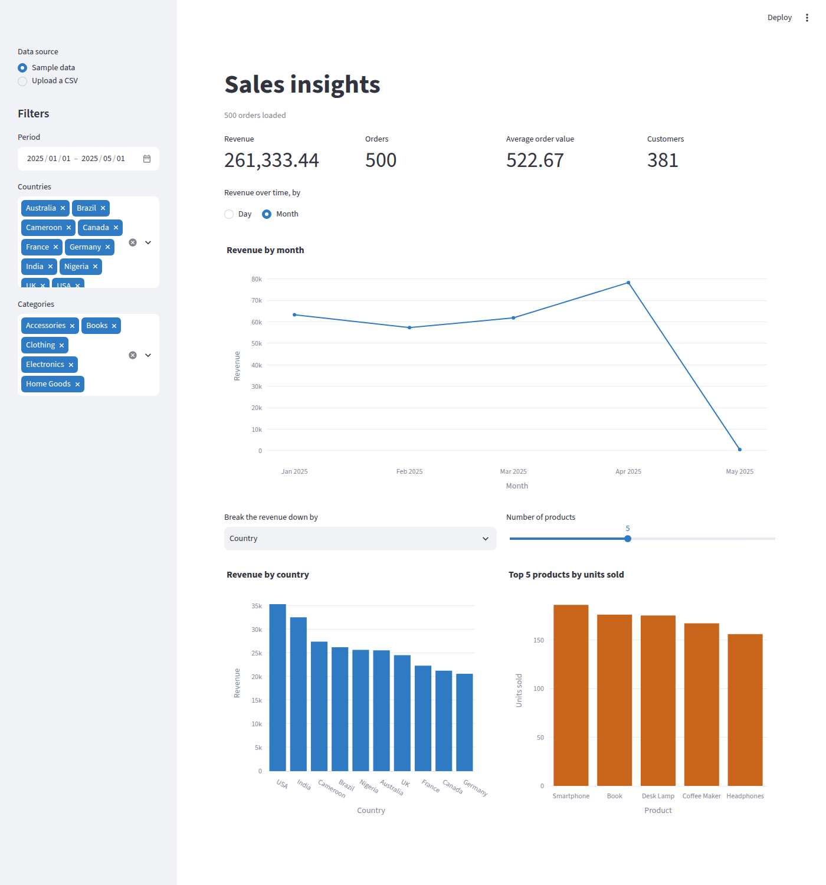

# E-Commerce Sales Dashboard

[](https://github.com/Priscilla47/E-Commerce-Sales-Dashboard_Project/actions/workflows/ci.yml)

A Python tool that turns an e-commerce orders CSV into answers: revenue, best-selling products, customers, countries and categories, from the command line or an interactive dashboard, with a revenue forecast and an AI layer that writes insights and answers questions in plain language without ever inventing a number.

> **Status: feature-complete for a first release.** Everything on the roadmap below is built, tested (more than 1,500 unit tests) and documented. The AI features are optional and switched off until a provider and a key are set.

## Features

- **Command line** (`sales-insights`): totals, best sellers, a product's units and customers, revenue by country, category or month, a forecast, a data check and questions in plain language. See [the command-line reference](docs/cli.md).
- **Dashboard** (Streamlit): key figures, charts, filters by period, country and category, and tabs for the forecast, the insights and questions. See [the dashboard guide](docs/dashboard.md).
- **Data checks**: a file with wrong columns, values or encodings is explained, line by line, instead of crashing. See [Data format](docs/data-schema.md).
- **Revenue forecast** with its error, measured against a naive baseline, so its accuracy is shown next to it.
- **Written insights and answers to questions**, worded by a language model from numbers that code computed. See [How the AI stays honest](#how-the-ai-stays-honest).
- **Container image** and a [deployment guide](docs/deployment.md).

## How the AI stays honest

The language model never calculates. For the insights it receives statistical facts computed by pandas; for a question it may only ask for one of twelve registered analytics functions, whose arguments are checked before they run. Every number of its text is then checked against the numbers that code returned, and a text with an invented, abbreviated or unverifiable number is retried once and then refused. Data from the file is always marked as data, never as instructions, and the functions used are shown next to every answer. The method, its tests and its limits are in [the AI guide](docs/ai.md).

## Command line

`sales-insights` reads an orders CSV and answers one question per option.

| Option                     | Description                                                  |
|----------------------------|--------------------------------------------------------------|
| `-h`                       | Show the help                                                |
| `-T`                       | Total revenue (quantity x unit price)                        |
| `-u`                       | List the unique products sold                                |
| `-p NAME`                  | Units sold for one product                                   |
| `-c NAME`                  | Number of unique customers who bought a product              |
| `-t N`                     | The N best-selling products                                  |
| `--by country\|category\|month` | Revenue, orders and share of the total for each value  |
| `--forecast N`             | Forecast the revenue of the next N months (1 to 12), with its error |
| `--ask QUESTION`           | Answer a question in plain language (needs the AI settings)  |
| `--validate`               | Check the data and print what is wrong with it               |

Put the CSV path last. Options can be combined and are answered in the order given. The exit code is 0 on success and 84 for a usage or data error, or a question that could not be answered (the message goes to stderr).

Every option, with real output and the error messages, is described in the [command-line reference](docs/cli.md).

## Requirements

- **Linux or macOS.** These are the supported platforms; Windows is not supported.
- Python 3.11 or newer.

## Quick start

```bash
git clone git@github.com:Priscilla47/E-Commerce-Sales-Dashboard_Project.git
cd E-Commerce-Sales-Dashboard_Project

python3 -m venv .venv
source .venv/bin/activate
pip install -e .

sales-insights -T data/sample_orders.csv
sales-insights -t 3 data/sample_orders.csv
sales-insights -p Laptop -c Laptop data/sample_orders.csv
sales-insights --by country data/sample_orders.csv
sales-insights --validate data/sample_orders.csv
```

Example output:

```
$ sales-insights -t 3 data/sample_orders.csv
1 - Smartphone  sold  186  times
2 - Book  sold  176  times
3 - Desk Lamp  sold  175  times
Top  3 :  ['Smartphone', 'Book', 'Desk Lamp']
```

## Data format

`data/sample_orders.csv` is a sample dataset of 500 orders with these columns:

| Column       | Description                         |
|--------------|-------------------------------------|
| `OrderID`    | Unique order identifier             |
| `Date`       | Order date (`YYYY-MM-DD`)           |
| `Product`    | Product name                        |
| `Category`   | Product category                    |
| `UnitPrice`  | Price of one unit                   |
| `Quantity`   | Units ordered                       |
| `CustomerID` | Customer identifier                 |
| `Country`    | Customer country                    |

See [Data format](docs/data-schema.md) for the full description, the loading rules and the validation checks.

## Project layout

```
.
├── src/sales_insights/
│   ├── analytics/   revenue, products, breakdowns, time series and filters
│   ├── cli/         command-line interface
│   ├── data/        data loading, validation and storage
│   ├── dashboard/   interactive dashboard and its views
│   └── ai/          forecast, facts, insights, questions, the number check and the model interface
├── tests/           unit tests
├── docs/            guides and decision records
├── data/
│   ├── sample_orders.csv
│   └── eval_questions.json
├── Dockerfile
└── docker-compose.yml
```

How the pieces fit together, the rule about what may import what, and how to add a function are described in [Architecture](docs/architecture.md). The choices behind them are explained in the [decision records](docs/decisions/README.md).

## Dashboard

The dashboard is an optional extra, so the command line stays light to install.

```bash
pip install -e ".[dashboard]"
streamlit run src/sales_insights/dashboard/app.py
```

Streamlit prints a link, usually `http://localhost:8501`. In the sidebar, choose **Sample data** (the file in `data/`) or **Upload a CSV** to load your own orders file (the columns are in [Data format](docs/data-schema.md)). Four cards show **Revenue**, **Orders**, **Average order value** and **Customers**, three charts show the revenue over time, the revenue by country or category and the best-selling products, a **Forecast** tab estimates the revenue of the next months, with its error, an **Ask** tab (or `--ask` on the command line) answers questions in plain language, with the functions it used shown, and an **Insights** tab lists the facts about the sales and, when you set `SALES_AI_API_KEY` (see [docs/ai.md](docs/ai.md)), has a language model word them, with every number checked; the **Period**, **Countries** and **Categories** filters in the sidebar change them all. A file that cannot be loaded shows what to change instead of a figure. The page is described, with screenshots, in [docs/dashboard.md](docs/dashboard.md).



## Docker

The image holds the dashboard and the command line, runs as a user without privileges and needs no local Python:

```bash
docker compose up --build                                          # the dashboard on http://localhost:8501
docker run --rm sales-insights sales-insights -T data/sample_orders.csv   # the command line
```

Settings, your own data, the hardening of the container and what a deployment on a server needs are in the [deployment guide](docs/deployment.md).

## Development

```bash
python3 -m venv .venv
source .venv/bin/activate
pip install -e ".[dev]"
pre-commit install

pytest
```

Every feature and every fix comes with unit tests. Tests live in `tests/` and use small fixtures that can be checked by hand.

Code style is checked by [ruff](https://docs.astral.sh/ruff/) (settings in `pyproject.toml`). `pre-commit install` runs ruff, a trailing-whitespace fixer and an end-of-file fixer before every commit; to run the same checks yourself:

```bash
ruff check .
ruff format --check .
pre-commit run --all-files
```

## Roadmap

- [x] Restructure into a proper Python package with tests and CI
- [x] Data loading with validation and clear error messages
- [x] More analytics: revenue by country, category and time period
- [x] Interactive dashboard
- [x] Revenue forecasting, with its error
- [x] Written insights, with the numbers checked against the facts
- [x] Answers to questions in plain language, checked against the functions that were run
- [x] A chat page and a command to ask a question
- [x] Docker image and deployment guide

Ideas for later: a provider package for a language model, customer segmentation (RFM), cohort retention, export of a report, a cloud storage backend.

## Contributing

Contributions are welcome. [CONTRIBUTING.md](CONTRIBUTING.md) explains how to set up the project, the rules a change follows and how to open a pull request; [CHANGELOG.md](CHANGELOG.md) lists what changed.

## Licence

MIT, see [LICENSE](LICENSE).
