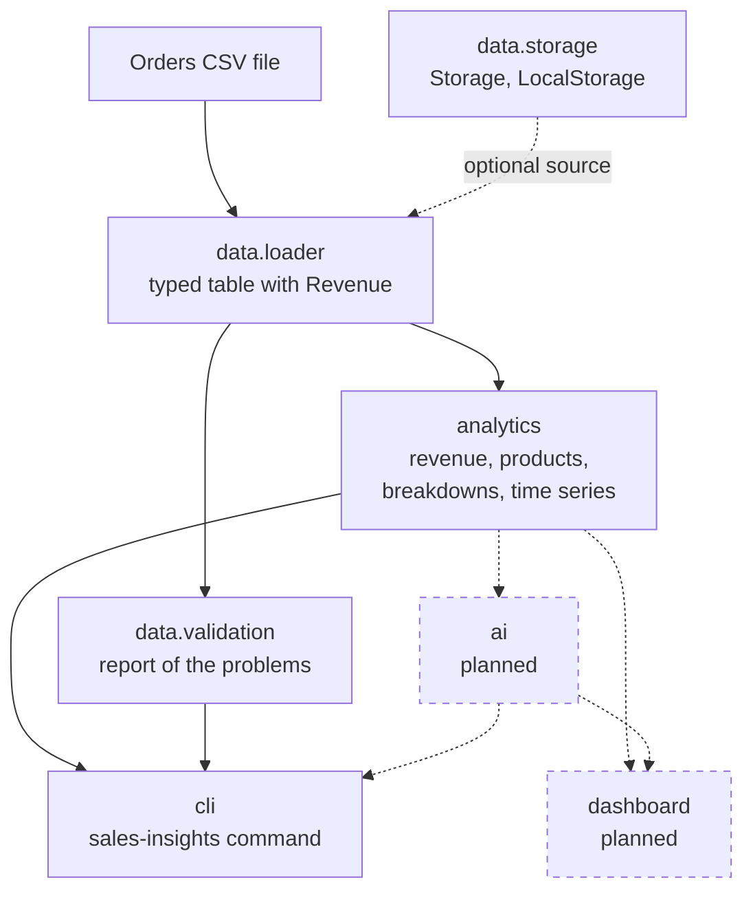

# Architecture

This page explains how the project is organised, so that you can find your way in the code, add to it, and know what is not built yet. For the commands, see the [command-line reference](cli.md); for the file format, see [Data format](data-schema.md).

## Goal and design principles

The project turns a CSV file of e-commerce orders into answers: how much was sold, what sells best, who buys what and where. It is meant to have two interfaces, a command line (working) and a dashboard (planned), and an AI layer (planned) that explains the figures in plain language.

Four principles shape the code:

1. **A pure analytics core.** Analytics functions receive a table and return numbers or tables. They do not print, read files, round their results or know who calls them.
2. **Thin interfaces.** The command line (and later the dashboard) only parses what the user asked for, calls the core and formats the result. It holds no calculation of its own.
3. **Numbers are computed by code.** Every figure comes from pandas. The planned AI layer may read these figures and put them into words, but it never calculates or invents one.
4. **Bad data is reported, not hidden.** Loading is strict about types and clear about what is wrong; validation is a separate step that lists every problem with its line number; the command line warns when the data has errors.

## Layers



Solid arrows exist today. Dashed arrows are planned, or optional: the command line reads a file by its path, while the storage interface exists so that a file can later come from somewhere else, such as a cloud bucket, without touching the rest of the code.

## Packages

The code is in `src/sales_insights/`. The table is also the **dependency rule**: a package may import only from the packages in its third column, never from the ones in its fourth. The tests read this table and check every import in the code against it.

| Package | Responsibility | May import | Must not import |
|---------|----------------|------------|-----------------|
| `data` | Reading, typing and checking order files | nothing else of the project | `analytics`, `cli`, `dashboard`, `ai` |
| `analytics` | Calculations on a loaded table | `data` | `cli`, `dashboard`, `ai` |
| `cli` | The `sales-insights` command | `analytics`, `data`, `ai` | `dashboard` |
| `dashboard` | The interactive dashboard (planned) | `analytics`, `data`, `ai` | `cli` |
| `ai` | The AI-assisted features (planned) | `analytics`, `data` | `cli`, `dashboard` |

### `data`

Everything between a file and a trustworthy table. `schema.py` defines the eight expected columns and their types and the `SchemaError` raised when a file does not match. `loader.py` has `load_orders`, which reads a path (or a file of a storage), checks the columns, converts every column to its type, computes the `Revenue` column and turns every problem into a `SchemaError` with a message that says what to change. `validation.py` has `validate_orders`, which never raises on bad data: it returns a report of errors and warnings with the lines concerned. `storage.py` defines the small `Storage` interface (`read`, `exists`, `list`) and `LocalStorage`, which refuses names that would leave its folder. `data` imports nothing else of the project, so it can be understood and tested alone.

### `analytics`

The calculations, as pure functions on the table that `load_orders` returns: `revenue.py` (total, order count, average order value, units), `products.py` (unique products, units, orders and customers for a product, the best sellers), `breakdowns.py` (revenue, orders and share by country, category or another text column) and `timeseries.py` (revenue and orders by day, month or year, with empty periods filled). A function returns a plain number or a table, never prints, never reads a file and rounds nothing: rounding is a matter of display. `analytics` may use `data` (for example the schema, to know which columns are text) but it must not know about any interface, because the same functions serve the command line, the dashboard and the AI layer.

### `cli`

The command line. `main.py` builds the `argparse` parser, loads the file, validates it, calls one analytics function per option and formats the answers; it is the only place that prints and the only place that decides an exit code (0, or 84 for a usage or data error). It holds no calculation: a figure the command line prints is a figure an analytics function returns.

### `dashboard` (planned)

The interactive dashboard. The package exists and is empty. It will follow the same pattern as the command line: load, call analytics, draw. It will not import `cli`.

### `ai` (planned)

The AI-assisted features: questions in plain language, written insights and revenue forecasting. The package exists and is empty. The rule that matters here is the third principle: it receives figures computed by `analytics` and turns them into words; it does not calculate. It must not import an interface.

## Data flow of a request

Take `sales-insights -T -t 3 data/sample_orders.csv`:

1. `cli.main.main` parses the arguments. The options become an ordered list of requests (`-T`, then `-t 3`) and the file is `data/sample_orders.csv`. A usage error stops here, with a message on stderr and exit code 84.
2. `data.loader.load_orders` reads the file as text, checks that the eight columns are there, converts each column to its type (dates, whole numbers, prices), and adds `Revenue` (unit price times quantity). A file that cannot be read this way raises a `SchemaError`, which the command turns into a message on stderr and exit code 84.
3. `data.validation.validate_orders` checks the content and returns a report. If it has errors and the user did not ask for `--validate`, the command prints a one-line warning on stderr and goes on.
4. For each request in order, the command calls an analytics function on the table: `analytics.revenue.total_revenue` for `-T`, `analytics.products.top_products` for `-t 3`.
5. The command formats what the function returned and prints it on stdout: `Total Revenue:  261333.44`, then the three best sellers.
6. The command returns the exit code, and the program exits with it.

## Add an analytics function

Say we want the average number of units per order. Four steps, each with a place:

1. **Write the function** in the analytics module of the same subject, here `src/sales_insights/analytics/revenue.py` (or a new module in the same folder when the subject is new). It takes the loaded table and returns a plain number or a table. Give it a docstring that says what it returns, what it does for empty data, and what it raises.
2. **Write its tests** in the matching file, here `tests/analytics/test_revenue.py`: import the new function at the top of the file and use the `loaded_orders` fixture, whose values can be checked by hand. Cover the normal case, empty data, a single order, a missing cell, and the type of the result. Write them first and see them fail.
3. **Document it.** The docstring is the documentation of the function. If it is also a command-line option, add the option in `cli/main.py`, its tests in `tests/cli/test_main.py`, and a row and an example in [the command-line reference](cli.md); the tests of that page fail until they agree with the code.
4. **Check everything**: `pytest`, `ruff check .` and `ruff format --check .` (or `pre-commit run --all-files`). The imports must stay sorted; `ruff check --fix .` sorts them for you.

The function and its test for the example look like this:

```python
def average_units_per_order(df: pd.DataFrame) -> float:
    """The units sold divided by the number of orders; 0.0 when there are no orders."""
    orders = df["OrderID"].nunique()
    return float(df["Quantity"].sum()) / orders if orders else 0.0


def test_average_units_per_order(loaded_orders):
    # 10 units over 6 orders, and nothing to divide by for an empty table.
    assert average_units_per_order(loaded_orders) == pytest.approx(10 / 6)
    assert average_units_per_order(loaded_orders.iloc[0:0]) == 0.0
```

The dependency rule applies as soon as the function is written: if it needs something from `cli`, `dashboard` or `ai`, the design is wrong, and the architecture test says so.

## How the tests are organised

`tests/` mirrors `src/sales_insights/`:

- `tests/data/`, `tests/analytics/` and `tests/cli/` hold the tests of the package of the same name, one test file per module.
- The fixtures are small tables whose results can be checked by hand. `orders` (in `tests/conftest.py`) is six lines, with a revenue of 1660.0, and `typed_orders_with_problems` is the same with two planted problems. `typed_orders` (in `tests/data/`) has its dates parsed, `loaded_orders` (in `tests/analytics/`) went through `load_orders`, and `orders_csv`, `faulty_csv` and `ranking_csv` (in `tests/cli/`) are files on disk.
- Every analytics function is also checked on the real sample dataset, `data/sample_orders.csv`, whose figures are written in the tests.
- The command line is tested by calling `main([...])` directly and reading stdout, stderr and the exit code; a few tests run it as a real program.
- The pages of `docs/` are tested against the code (`test_docs_*.py`): the columns, the options, the examples with their output, the error messages and the links must match what the code does. This page is one of them.
- A test of the package checks the dependency rule above.
- `pytest` runs everything; `pytest tests/analytics` runs one package. A bug starts as a failing test, and a defect that is known but not fixed yet is written as a strict `xfail` test, so that fixing it makes the test fail until the marker is removed.
