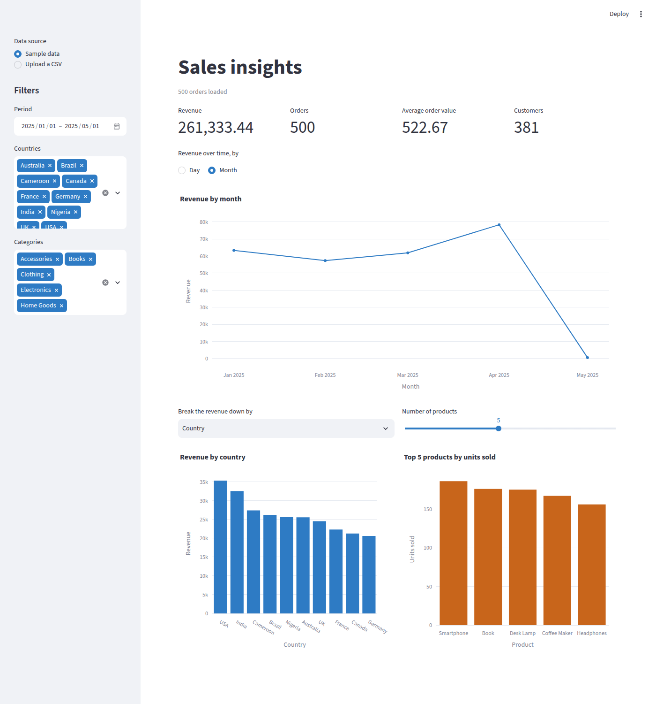
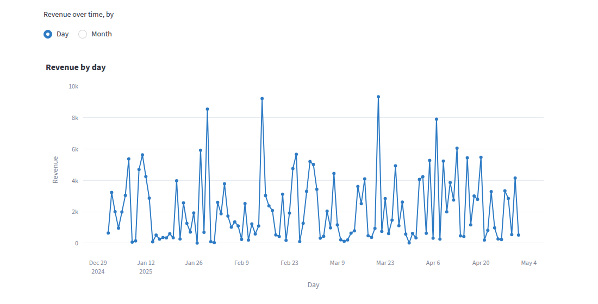
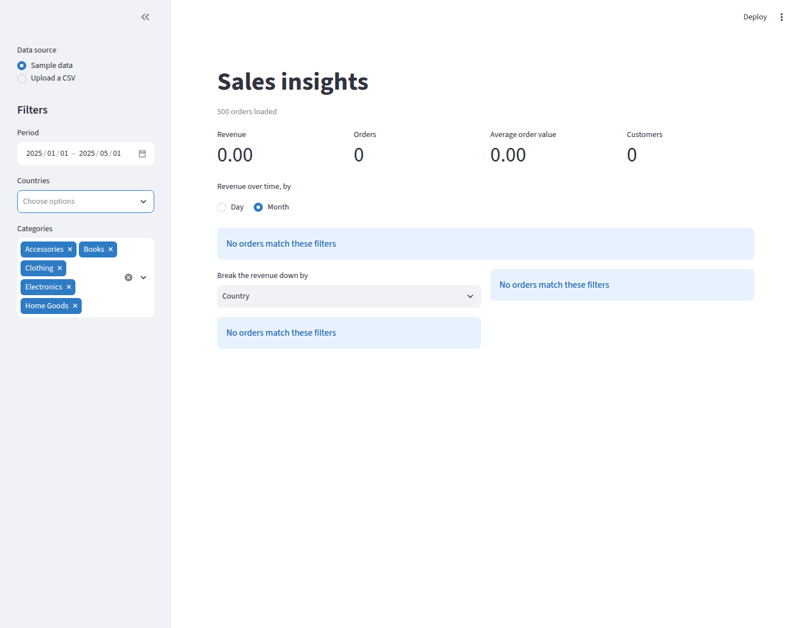
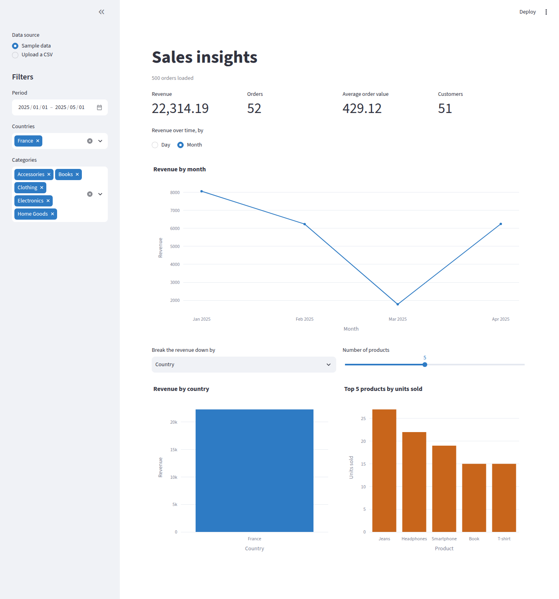
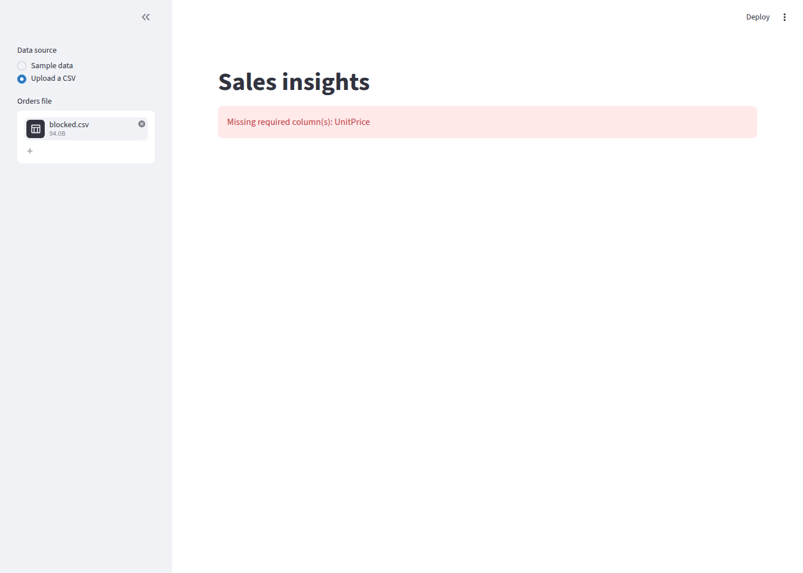
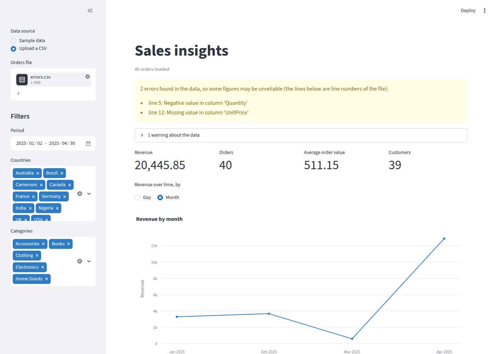

# Dashboard

The dashboard shows the key figures and three charts of a file of orders, and lets you narrow them by period, country and category. It uses the same calculations as the [command line](cli.md); for how the pieces fit together, see the [architecture](architecture.md), and for the columns of a file, see [Data format](data-schema.md).

## Start it

```bash
pip install -e ".[dashboard]"
streamlit run src/sales_insights/dashboard/app.py
```

Streamlit prints a link, usually `http://localhost:8501`. Streamlit is an optional extra: the command line and the calculations work without it. Start the command from the root of the project: Streamlit reads the theme of the page from `.streamlit/config.toml` there.



## The sidebar

- **Data source**: **Sample data** is the file `data/sample_orders.csv` of the repository. **Upload a CSV** lets you choose your own file, with the columns described in [Data format](data-schema.md).
- **Period**: the first and the last day to keep, both included. It starts on the first and the last day of the data and is not shown when the data has no date.
- **Countries** and **Categories**: the values to keep. Everything is selected at first, which filters nothing (an order without a country is still counted). Unselect everything and no order matches, so every figure is zero.

## The key figures

Four cards sit at the top of the page and follow the filters:

- **Revenue**: the sum of unit price times quantity.
- **Orders**: the number of distinct order numbers.
- **Average order value**: the revenue divided by the orders, `0.00` when there are no orders.
- **Customers**: the number of distinct customers.

Money is shown with two decimals and thousands separators; the exact values are never rounded before they are shown.

## The charts

Three charts sit under the cards. They show the same orders as the cards, so they follow the filters too. The data has no currency column, so no chart names a currency.

- **Revenue by month** (or by day): a line of the revenue of each period. **Revenue over time, by** switches between **Day** and **Month**. A month or a day without any order is drawn at 0, so a gap in the sales shows as a dip and not as a missing point. Hover a point to read its revenue and its number of orders.
- **Revenue by country** (or by category): one bar for each value, the highest first. **Break the revenue down by** switches between **Country** and **Category**.
- **Top 5 products by units sold**: the best sellers by quantity. **Number of products** goes from 1 to the number of products of the data and starts at 5. When the data has a single product there is nothing to choose and the slider is not shown.



Each figure is the one `analytics` returns: the charts only draw it (see the [architecture](architecture.md)). The blue and orange of the charts keep a contrast of at least 3 to 1 with a white page and with a dark one.

### When nothing matches

If the filters keep no order, for example when no country is selected, each chart is replaced by the message `No orders match these filters`. The cards stay on screen and show zeros. The same happens for a file that has a header and no order, and for the time chart alone when no order has a date.



Choosing a country again, or any filter that keeps orders, brings the charts back.



## What the page says about your data

A file can be in one of three states.

### Blocked

The file cannot be read as a table of orders: it is empty, it is not text, it is not a CSV, a column is missing or a value cannot be read. The page shows one red message that says what to change, the same as the command line prints, and no figure.

```csv
OrderID,Date,Product,Category,Quantity,CustomerID,Country
1,2025-01-05,Book,Books,2,C1,France
```

The page shows:

```text
Missing required column(s): UnitPrice
```



### Loaded with errors

The file is read but some lines have errors, such as a negative quantity or a missing price. The page shows a yellow box that lists them and then shows the figures anyway, as the command line does, because a few bad lines do not make the rest useless. Each line of the list starts with the line number in your file (the header is line 1). The box lists the first 20 lines and ends with `and N more` when there are more.

```csv
OrderID,Date,Product,Category,UnitPrice,Quantity,CustomerID,Country
1,2025-01-05,Book,Books,10,-2,C1,France
2,2025-01-06,Laptop,Electronics,,1,C2,UK
3,2025-01-07,Book,Books,10,2,C3,France
```

The box lists:

```text
line 2: Negative value in column 'Quantity'
line 3: Missing value in column 'UnitPrice'
```



### Loaded

No error. If the validation has warnings only (a quantity of zero, a date in the future, text with extra spaces, a name written with different capitals), they are in a collapsed note under the page title, such as "1 warning about the data", which you can open to read them. The figures do not change.

## The page never shows a traceback

Whatever file is uploaded, the page ends in one of the three states above. The tests give it empty files, binary files, files cut or damaged at random places and files in another encoding.
